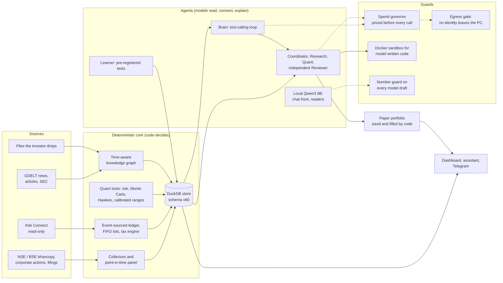

# Portfolio Lab

**An autonomous, local-first research companion for an Indian equity portfolio.** It collects market data, filings and news by itself, keeps a tax-aware
ledger, researches with a team of LLM agents under strict cost and privacy controls, tests its own ideas as pre-registered studies, and runs a paper
portfolio on its own judgement. **It never places an order.**

> Maths decides; models read, connect and explain.


| | |
|---|---|
| **Code** | ~70,000 lines of Python in 26 packages (`src/pflab`), ~35,000 lines of tests |
| **Tests** | 3,065 synthetic tests (unit, migration, restart drills, headless-browser UI) |
| **Releases** | 70 tagged releases, installed and self-updated with backup and rollback |
| **Store** | one DuckDB file, schema v60, migrates itself |
| **Runs** | 30+ scheduled jobs, 23 agents on one task board, a 15-minute tick that survives sleep and restarts |

---

## Why it exists
Most people who invest are not traders. They invest by feel and do not have time to read every filing, check every corporate action or work out the tax on a sale.
Portfolio Lab is meant to be the analyst who does that work every day: it watches, investigates, measures, and brings a reasoned suggestion with a price and its
tax effect. The investor decides. It runs on a laptop, keeps personal data on that laptop, and spends at most a fixed monthly budget on cloud models.

The design rule behind everything: **language models are good at reading and connecting, and bad at being trusted with numbers.** So every number shown comes
from code, every claim of an "edge" must pass a pre-registered test on unseen data, and every model draft is checked against the facts before anyone sees it.

## What it does
- **Collects data by itself.** NSE and BSE daily prices, corporate actions, dividends, BSE filings and shareholding, insider and bulk deals, F&O data, FPI flows,
  GDELT news, macro series, US prices and SEC filings. Collection is point-in-time and survivorship-free, and the market history back to 2012 backfills itself.
- **Keeps a tax-aware ledger.** An event-sourced ledger with FIFO lots, fees and income, and Indian capital-gains tax from dated, sourced rule tables. It prepares
  the Schedule 112A inputs for filing. Its tax figures matched a broker's tax P&L to 3 paise.
- **Researches with a team of agents.** A coordinator plans an investigation, research and quant workers gather evidence and run calculations, and an
  independent reviewer reproduces and checks the work before an answer is written. Evidence carries its stance (for, against, missing) and its timestamps.
- **Tests its own ideas.** A learner reads papers and blogs, turns claims into registered tests with frozen protocols, runs them on a development and a
  validation period, and counts every test. The bar rises with each one, so a lucky result cannot slip through.
- **Runs a paper portfolio alone.** A fake-money account seeded from real holdings: the agents decide the direction and the reasons, while code sets the sizes,
  enforces the position and sector limits, fills orders only inside exchange sessions, and computes the tax. Every decision is scored later against the Nifty 500.
- **Reports simply.** A local dashboard (Today, Account, Watchlist, Research, Assistant, System), a chat assistant over the whole system, and Telegram alerts only
  when something matters, plus a morning and an evening summary.

## Architecture



One process holds the store: the desktop app starts the dashboard and every job together, and a scheduled tick runs what is due when the window is closed.
Long agent work is a **mission** on a durable task board (queued, running, waiting, retry, needs approval, done, failed), with leases, bounded attempts and
recorded effects. A killed process resumes where it stopped, without doing anything twice.

## Engineering highlights

**Safety by construction, not by prompt**
- **No trading path exists.** The broker SDK sits behind a read-only allowlist: no order, GTT or SIP method is reachable from any agent or tool.
- **Model-written code runs only in Docker**, with no network, a read-only root, capabilities dropped and 2 GB of memory. There is **no fallback to the host**:
  if Docker is missing the calculation waits. A daily probe proves containment for each release, and a second model writes the same calculation independently
  for comparison.
- **No model-made numbers.** A local draft containing a number that is not in its facts is dropped, and the facts are shown instead. Cloud answers pass a
  sourced-numbers check.
- **Privacy.** An egress gate decides what may leave the machine (portfolio figures may; identity and banking details never). Token-shaped strings are scrubbed
  from logs and stored rows, and a pre-push hook greps the diff for personal data.

**Cost control for LLM agents**
- Every cloud call is priced before it is made and refused above the monthly cap, with day limits, per-layer shares, per-mission budget classes and tool caps
  as configuration.
- Prompt caching on every multi-turn loop; the cheapest model that passes a measured test gets each job (see below); and a local model handles common chat
  turns for free, with a GPU queue so only one local call runs at a time.

**Research discipline**
- **Point-in-time or not at all.** A feature at date M uses only rows dated on or before M; announcements use the dissemination timestamp; index membership is
  rebuilt historically from archived factsheets to avoid survivorship bias.
- **Data facts verified, not assumed.** For example, NSE's previous-close field is *not* adjusted on ex-dates (450 of 451 large down-gaps from 2012 to 2020), so
  split and bonus factors come from the corporate-actions feed and are tested on known events.
- **Pre-registration and a multiple-testing bar.** A protocol is committed and hashed before a run, and every test counts toward a threshold that rises with N
  (deflated Sharpe). Results under 20 observations carry their count and no conclusion.

**Reliability and operations**
- Two installations: the **app** (a release tag in its own folder) and the **workshop** (this checkout, which sends nothing and spends nothing unless told).
- Self-update at each start: back up the store, install the newest tag, self-test, and roll back on failure.
- A local acceptance tool (`pflab verify`) runs a candidate's migrations, an upgrade and rollback rehearsal, and a force-kill restart drill on copies of the
  live record, and proves the live ledger file was untouched.
- A nightly self-check probes every read tool with a known input. A tool that fails twice is quarantined until it passes.

## What the research found
Being honest about failures is part of the design. A sample from [`docs/STUDIES.md`](docs/STUDIES.md):

| Claim tested | Verdict |
|---|---|
| Large Nifty falls cluster in time (Hawkes process) | **pass**: drives the market-state gauges |
| Extra buys on a 10% market dip into safe stocks | **pass**: live as dip alerts |
| Hybrid embedding + keyword retrieval beats keywords alone (recall@5 0.575 vs 0.425) | **pass**: live in memory search |
| Waiting for a "buy zone" beats buying at once | fail |
| Cointegrated pairs trading | fail |
| Insider, institutional or bulk-deal buying predicts 3-month excess returns | fail on all three |
| A zero-shot time-series foundation model (TimesFM) for volatility, falls or returns | fail on every question, removed |
| Stocks below their 200-day average earn less next month | **pass** as an *avoid* rule |

**Model choices are measured too.** On synthetic dossiers with planted faults, Sonnet 5.5 caught 24 of 24 faults, as Opus 5.5 did, at about a third of the
cost, so it now takes the reviewer seat. A local Qwen3 8B chat front failed its first safety test (4 unsafe acts at high confidence). The risky intents were
switched off, and the shipped version then passed an unseen holdout with 0 unsafe acts.

## Tech stack
| Area | Tools |
|---|---|
| Data and storage | pandas, NumPy, PyArrow (long-format Parquet), DuckDB |
| Statistics | statsmodels (cointegration, Newey-West), Monte Carlo, Hawkes processes, stationary bootstrap |
| LLMs | Anthropic SDK (Claude Opus / Sonnet / Haiku 5.5), Ollama with Qwen3 8B and nomic-embed-text, LangGraph |
| Documents | pypdf, casparser, openpyxl, xlrd, msoffcrypto-tool, trafilatura |
| Broker | kiteconnect (read-only wrapper) |
| App | FastAPI and Uvicorn on 127.0.0.1, vanilla JS front end, Telegram |
| Isolation and ops | Docker sandbox, PowerShell installers, Windows scheduled tasks |
| Testing | pytest, synthetic fixtures, headless Edge for the UI |

## Repository layout
```
src/pflab/
  data/  ingest/       collectors, parsers, file recognition by content
  ledger/  tax/        event-sourced ledger, FIFO lots, dated tax rules, filing pack
  pm/                  the DuckDB store and its migrations
  quant/  risk/  plan/ forecasts, Hawkes, charts, Monte Carlo, scenarios, targets
  backtest/  eval/     the engine and its protected tests, model evaluations
  hq/                  brain, missions, workers, governor, egress gate, self-check
  agents/  llm/        agents, Docker sandbox, local model client and guard
  kg/  learner/        knowledge graph and memory; claims, protocols, test counter
  paper/               the autonomous paper portfolio: book, rails, manager
  service/  app/       jobs and the tick; the FastAPI dashboard
configs/               tax tables, costs, calendars, models (all dated and sourced)
docs/                  PLAN, BUILT, STUDIES, RUNNING, frozen protocols
sandbox/  tools/       sandbox image; backfills, installers, verifier
tests/                 3,065 synthetic tests
```

## Quick start (development)
Windows 11 and Python 3.13. Install [Ollama](https://ollama.com) and pull `qwen3:8b-q8_0` and `nomic-embed-text`. Docker Desktop is optional (without it,
sandboxed calculations wait).
```powershell
git clone <this repository's URL> portfolio-lab
cd portfolio-lab
python -m venv .venv
.venv\Scripts\pip install -e ".[dev]"
.venv\Scripts\python -m pytest -q --basetemp .\tmp-pytest
.venv\Scripts\python -m pflab.cli --help
```
A checkout is the **workshop**: it sends nothing outward and makes no paid API call unless run with `--live` or `--paid`. Installing the app, keys, backfills,
updates and release acceptance are covered in [`docs/RUNNING.md`](docs/RUNNING.md).

## Documentation
| File | What it holds |
|---|---|
| [`docs/RUNNING.md`](docs/RUNNING.md) | install, first run, updates, release acceptance, development |
| [`docs/BUILT.md`](docs/BUILT.md) | the system as built: packages, jobs, tools, agents, tables, settings |
| [`docs/STUDIES.md`](docs/STUDIES.md) | every pre-registered test and its verdict |
| [`docs/PLAN.md`](docs/PLAN.md) | intent, fixed decisions, dated amendments, what remains |
| [`docs/protocols/`](docs/protocols/) | frozen study protocols (hashed at registration) |
| [`CLAUDE.md`](CLAUDE.md) | the rules for AI-assisted development of this repo |

## Disclaimer
A personal research project. It is not investment advice, places no orders, and its paper results describe the past, not the future.
